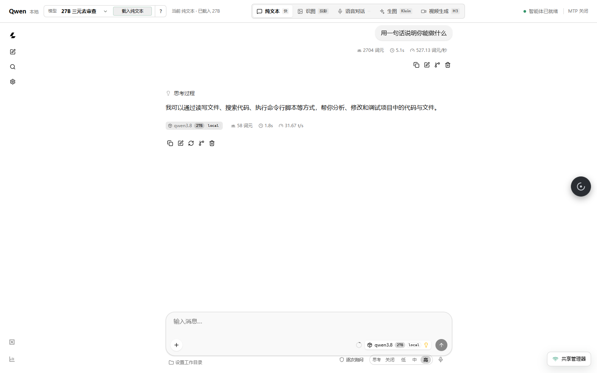
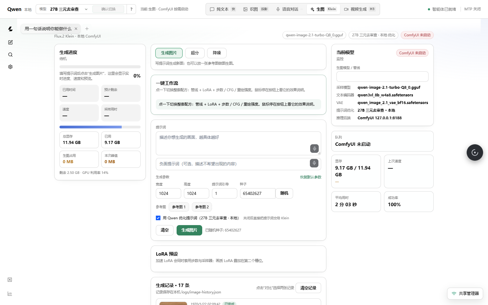
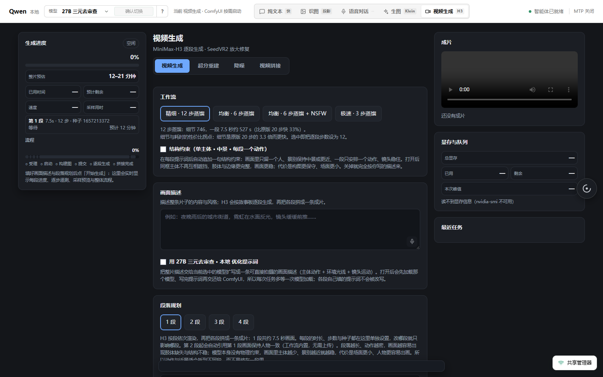
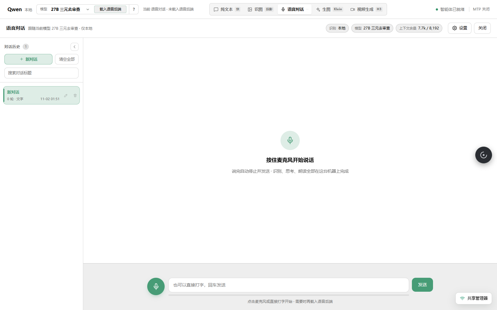

# 本地部署 AI 文字语音对话、图像视频生成一键式网站

把 AI 装进自己的电脑，浏览器打开一个网页就能用：聊天、看图、画图、做视频、说话，全在这一个页面里。
模型跑在本地，对话和文件不出这台机器。



## 打开网页后，你能干这些事

- **聊天、看图** —— 打字问它，或者直接丢一张图片让它读内容。回答是一段段蹦出来的，中途可以停。
- **让它画图** —— 写一句画面描述，选尺寸、步数、种子，等一两分钟出图。可以挂参考图，可以套 LoRA 加速，出过的图有记录。
- **让它做视频** —— 写一段画面描述，它自己拆成几个镜头逐段生成，最后拼成一条片子。**很慢**，三段的小片子按小时算，显卡要一直占着。
- **跟它说话** —— 按住麦克风说，本地识别成文字，它回答完再用本地语音念出来，中间不联网。
- **看自己用了多少** —— 每次请求的 token 数、耗时、每秒多少字，都有记录（只记数字，不记你说的话）。
- **临时分享给别人** —— 可选功能，生成一个口令发给朋友，他在浏览器里就能用，而且你能限制他能不能传图、能不能看别人的东西。

生图、视频、语音三块面板，和聊天共用一个网关、一份模型：

<table>
<tr>
<td width="50%"></td>
<td width="50%"></td>
</tr>
<tr>
<td></td>
<td><em>生图 / 视频 / 语音，都是网页里直接操作。</em></td>
</tr>
</table>

## 用的是哪些模型，从哪下

全是公开的开源权重，**仓库里不放权重**，得自己下（点仓库名就是下载页）。下面是这份代码实际跑过的那一套：

| 用来干什么 | 模型文件 | 大小 | 从哪下 |
| --- | --- | --- | --- |
| 聊天 + 看图（默认） | `Bonsai-2-27B-PQ2_0-CRACK.gguf` + `Ternary-Bonsai-2-27B-mmproj-Q8_0.gguf` | 6.7 + 0.6 GB | [dealignai/Bonsai-2-27B-Ternary-CRACK-GGUF](https://huggingface.co/dealignai/Bonsai-2-27B-Ternary-CRACK-GGUF)、[prism-ml/Ternary-Bonsai-2-27B-gguf](https://huggingface.co/prism-ml/Ternary-Bonsai-2-27B-gguf) |
| 聊天（省显存的备选） | `Qwen3.5-9B-Uncensored-HauhauCS-Aggressive-Q6_K.gguf` + `mmproj-…-BF16.gguf` | 6.9 + 0.9 GB | [HauhauCS/Qwen3.5-9B-Uncensored-HauhauCS-Aggressive](https://huggingface.co/HauhauCS/Qwen3.5-9B-Uncensored-HauhauCS-Aggressive) |
| 语音识别（你说的话转文字） | `Qwen3-ASR-0.6B-Q8_0.gguf` + `mmproj-Qwen3-ASR-0.6B-Q8_0.gguf` | 0.8 + 0.2 GB | [ggml-org/Qwen3-ASR-0.6B-GGUF](https://huggingface.co/ggml-org/Qwen3-ASR-0.6B-GGUF) |
| 语音朗读（文字转人声） | `Qwen3-TTS-12Hz-1.7B-CustomVoice` + `Qwen3-TTS-Tokenizer-12Hz` | 3.7 + 0.7 GB | [Qwen/Qwen3-TTS-12Hz-1.7B-CustomVoice](https://huggingface.co/Qwen/Qwen3-TTS-12Hz-1.7B-CustomVoice)、[Qwen/Qwen3-TTS-Tokenizer-12Hz](https://huggingface.co/Qwen/Qwen3-TTS-Tokenizer-12Hz) |
| 画图 | `CyberRealisticPony_V18.0_F16` + `t5xxl_fp8_e4m3fn` + `Chroma ae` | 6.9 + 4.9 + 0.3 GB | [cyberdelia/CyberRealisticPony](https://huggingface.co/cyberdelia/CyberRealisticPony)、[comfyanonymous/flux_text_encoders](https://huggingface.co/comfyanonymous/flux_text_encoders)、[lodestones/Chroma](https://huggingface.co/lodestones/Chroma) |
| 做视频 | `MiniMax-H3-ref2va-curve-Q4_0.gguf` + 文本编码器 + VAE + 8 步加速 LoRA | 11.5 + 15.7 + 5.8 + 2 GB | [joeygambino/MiniMax-H3-curve-GGUF](https://huggingface.co/joeygambino/MiniMax-H3-curve-GGUF)、[Comfy-Org/MiniMax-H3](https://huggingface.co/Comfy-Org/MiniMax-H3) |
| 跑模型的后端 | llama.cpp 两份构建：原版 `b11935`、Prism fork `b10826` | — | [ggml-org/llama.cpp](https://github.com/ggml-org/llama.cpp/releases)、[PrismML-Eng/llama.cpp](https://github.com/PrismML-Eng/llama.cpp/releases) 的 Windows CUDA 包 |

画图和做视频还需要 [ComfyUI](https://github.com/comfyanonymous/ComfyUI)；`ffmpeg.exe` 放进 `runtime\` 用来拼接和降噪。
**每个文件该放哪个目录、哪些是必须的、仓库自带的下载脚本怎么用，都写在 [docs/MODELS.md](docs/MODELS.md)。**

## 怎么跑起来

1. **装依赖**（Python 3.12）

   ```powershell
   git clone https://github.com/woshishauige/local-ai-studio.git
   cd local-ai-studio
   $env:QWEN_PYTHON = "C:\Python312\python.exe"
   & $env:QWEN_PYTHON -m pip install -r requirements.txt
   powershell -ExecutionPolicy Bypass -File .\setup.ps1   # 检查环境缺什么
   ```

2. **放模型**：按上面那张表下载，放进 `models\` 下对应目录（比如 `models\Bonsai-2-27B-CRACK\`）；
   llama.cpp 解压到 `runtime-stock-11935\` 和 `runtime-prism-10826\`，`ffmpeg.exe` 放 `runtime\`。

3. **启动**：双击 `Start-Qwen.bat`，浏览器会自动打开 <http://127.0.0.1:8081>。
   第一次要等模型加载（几十秒），顶栏显示"已载入"就能用。停止用 `Stop-Qwen.bat`，会把显存还回来。

## 需要什么机器

Windows 10/11 + NVIDIA 显卡。**12 GB 显存**能跑默认的 27B（三元量化，全部塞进显卡）；
显存小就用 9B。内存 32 GB 更舒服，硬盘要留几十 GB 给模型。

## 现在还做不到 / 要注意

- 只在 **Windows + NVIDIA** 上验证过，别的平台没试。
- **视频很慢**，一段按分钟算，一条片子按小时算，跑的时候显卡基本别想干别的。
- 一台机器**只能开一个**：两个实例会同时加载模型、抢显存。
- ComfyUI 的节点包是按**目录名**精确加载的，名字装错对应的节点就不会出现（细节见 [docs/COMFYUI.md](docs/COMFYUI.md)）。
- 仓库里没有权重、没有你的聊天记录、没有声音样本；装好之后也不会向任何地方上传东西。

## 许可

代码是 MIT，随便用。模型和 ComfyUI 是别人家的，许可各自看上游，见 [docs/NOTICE.md](docs/NOTICE.md)。

---

English: a local-first AI website for one Windows PC with one GPU — chat/vision, ComfyUI image and video
generation, and offline speech, all in one page. Weights are not bundled; see `docs/MODELS.md`. MIT (code only).
